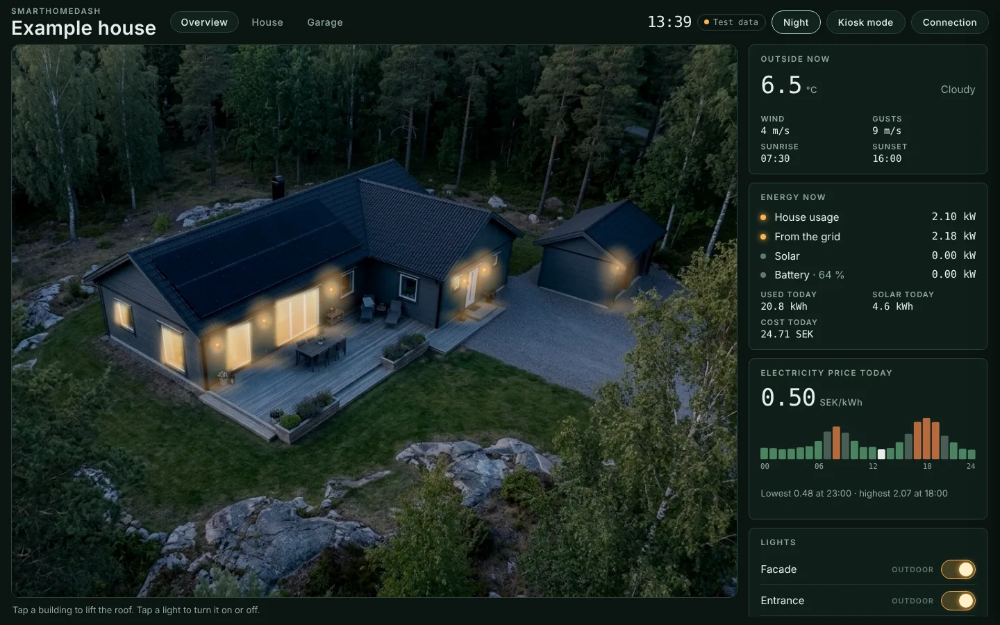
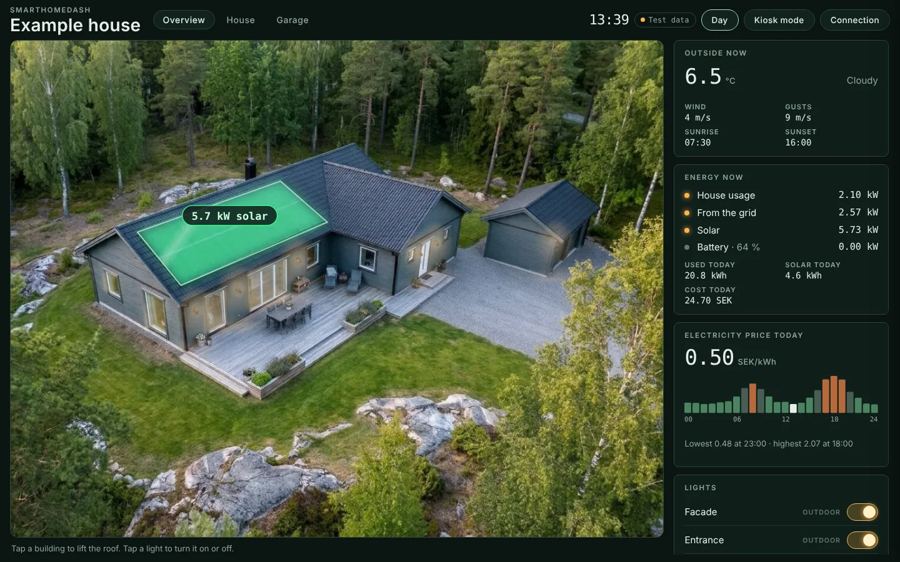
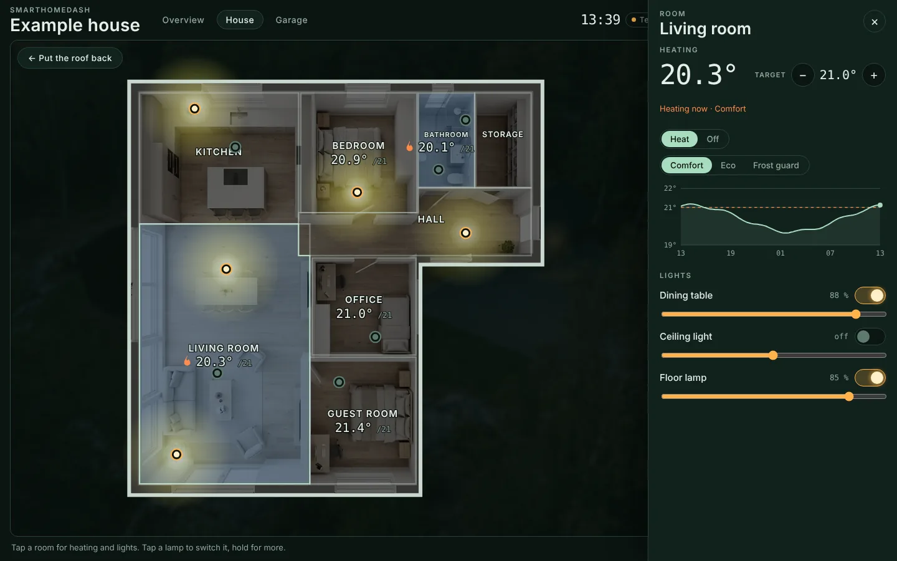
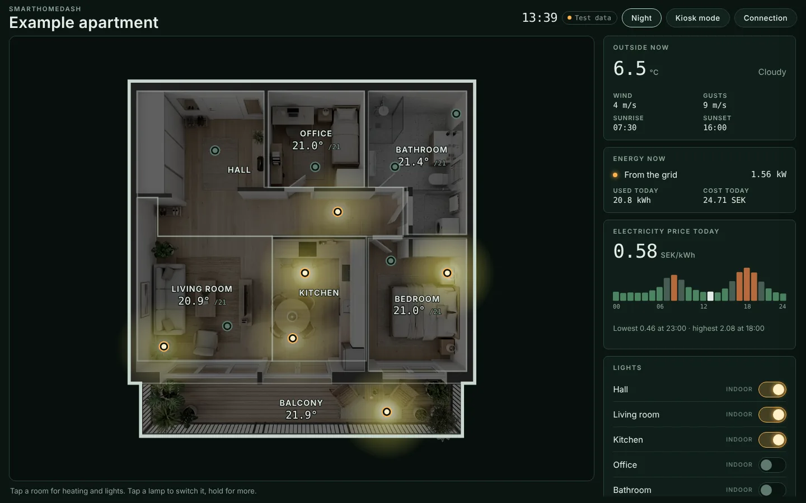

# SmartHomeDash

A Home Assistant dashboard that shows your home as a picture. Lights glow where they are, wall lamps wash the facade, windows light up when a room's lamps are on, and solar panels glow green while they produce. Tap a building and the roof lifts to reveal its floor plan, with every lamp and thermostat controllable in place.

- Runs as a panel in the Home Assistant sidebar, behind Home Assistant's own login. No access tokens.
- Set up entirely in the UI: upload a picture of your home and your floor plans, draw rooms, tap where each light and thermostat is.
- Built for wall screens and tablets, with a kiosk mode that shows only the dashboard; works in the companion app.
- Houses with a picture from outside, or apartments with just a floor plan. Several homes, each with its own panel.
- Dashboard text in Swedish or English.

<p>
  
  
</p>
<p>
  
  
</p>

## Install

**HACS:** HACS → *Custom repositories* → add this repository as an **Integration** → download **SmartHomeDash** → restart Home Assistant.

**Manually:** copy `custom_components/smarthomedash` to `<config>/custom_components/`, then restart. With SSH: `scripts/deploy.sh user@host`.

Then **Settings → Devices & services → Add integration → SmartHomeDash**, give the dashboard a name, and open it from the sidebar. It starts from an example house or apartment you can keep, fill with your own lights, or replace with pictures of your home; a setup guide walks through it.

**→ [Setting up a new dashboard](docs/setup.md)**: the full walkthrough, with tips for the pictures.

## What it shows

| Part | What it does |
| --- | --- |
| Overview picture | Day and evening picture of the property; lights, lit windows and solar panels drawn live on it |
| Lift the roof | Tap a building to open its floor plan |
| Floor plan | Rooms tinted by temperature, every lamp switchable in place, a flame where a room is heating |
| Room panel | Thermostat with target, mode and presets (Comfort, Eco, Frost …), 24-hour temperature graph, dimmers |
| Cards | Weather, power now, energy today, hourly electricity price, outdoor and indoor lights, scenes and scripts, heating per room |

## Wall screens and tablets

Open the dashboard with `?kiosk` at the end of its address, for example `http://homeassistant.local:8123/home?kiosk`, or tap **Kiosk mode** in the header. Kiosk mode hides Home Assistant's sidebar on that device, hides the dashboard's own buttons and goes full screen on the first touch. Hold the clock for two seconds to leave it.

For a dedicated tablet, also see [docs/setup.md](docs/setup.md#wall-screens-and-tablets).

## Setup and placement

Administrators get two tools in the dashboard header:

- **Setup** (*Inställningar*): pictures, buildings, solar panels, windows, floor plans and rooms, energy and weather sensors, buttons.
- **Place** (*Placera*): pick a light, switch, thermostat or temperature sensor and tap where it is. The room is found from the tap.

Both save straight to Home Assistant. The config is a readable `site.json` in `<config>/smarthomedash/sites/<name>/`; the format is described in [docs/configuration.md](docs/configuration.md).

## YAML

Dashboards can also be defined in `configuration.yaml`, for example to keep a site in version control:

```yaml
smarthomedash:
  dashboards:
    - site: home               # folder under <config>/smarthomedash/sites/
      title: Home
      icon: mdi:home-lightbulb
      url_path: home
```

## Updating

Through HACS like any other integration. Without HACS, `smarthomedash.update` installs the latest version from GitHub; set `github_token` (a read-only token for a private fork) and optionally `repository` and `branch` under `smarthomedash:` in `configuration.yaml`. It keeps your `site.json`, adds new site files, and says whether Home Assistant needs a restart. The same action is available as **Uppdatera dashboarden** in placement mode.

## Development

No build step: plain HTML, CSS and JavaScript modules.

```bash
python3 -m http.server 8000
```

`http://localhost:8000/` runs the example house standalone on **test data**: lights switch, thermostats respond and temperatures drift. `?site=example-apartment` shows the example apartment: a floor plan only. Add `#edit` for placement mode.

```
custom_components/smarthomedash/
  __init__.py              setup, panels, the update action
  config_flow.py           adding a dashboard from the UI
  views.py                 dashboard code (public) and site files (logged-in users)
  updater.py               installing a version from GitHub
  frontend/
    panel.js               panel entry point (runs in the Home Assistant iframe)
    js/main.js             startup, views and navigation
    js/ui/setup.js         setup guide
    js/ui/editor.js        placement mode
    js/views/              overview picture and floor plan
    js/adapters/           data from the panel's hass object, a token, or test data
  example/                 example house and apartment: pictures and config (English and Swedish)
sites/                     sites for the standalone page; example-house links to the example
docs/                      setup guide and config reference
scripts/deploy.sh          copy to Home Assistant over SSH
index.html                 standalone page for development
```

## Privacy

- Everything stays in your Home Assistant: the config and pictures are files in your config folder, served only to logged-in users.
- The dashboard makes no calls to outside services. The typefaces ship with it.
- Pictures you upload are not processed or sent anywhere.

See [SECURITY.md](SECURITY.md) for how access is handled and how to report a problem.

## Support

SmartHomeDash is free and open source. If it brightens your wall, you can support its development through [GitHub Sponsors](https://github.com/sponsors/rsundin) or [Buy Me a Coffee](https://buymeacoffee.com/rsundin).

## License

MIT, see [LICENSE](LICENSE). The bundled typefaces (Barlow, Barlow Semi Condensed, IBM Plex Mono) are under the SIL Open Font License.
