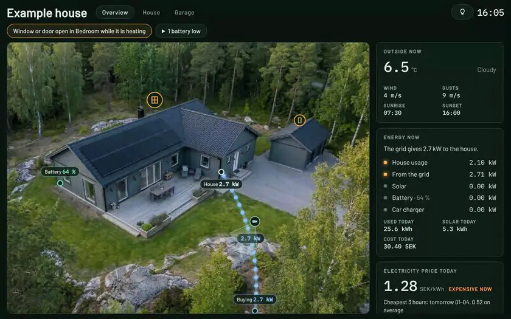
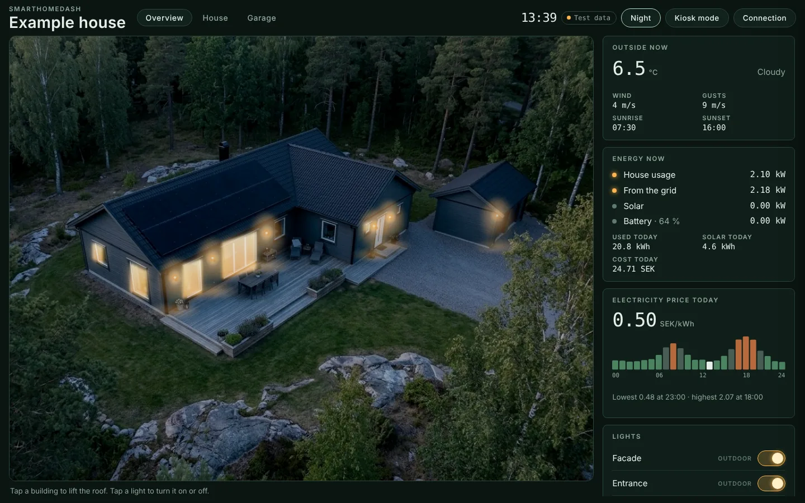
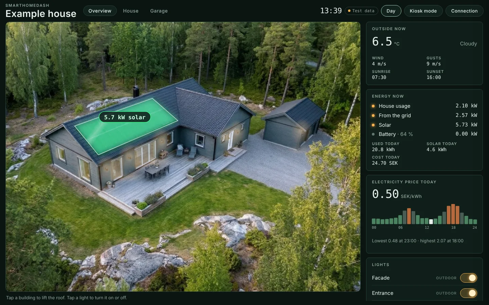
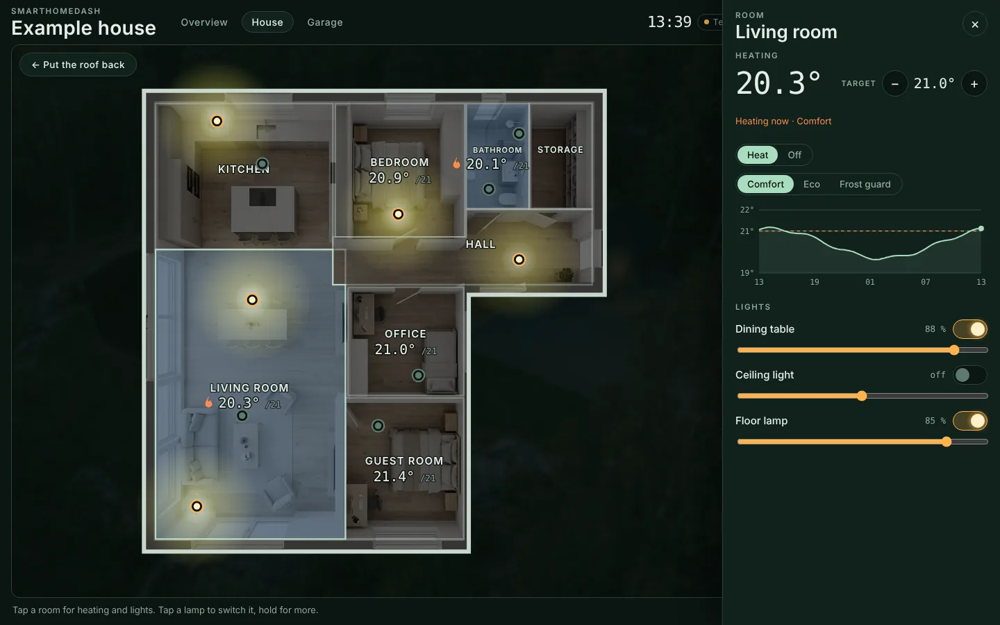
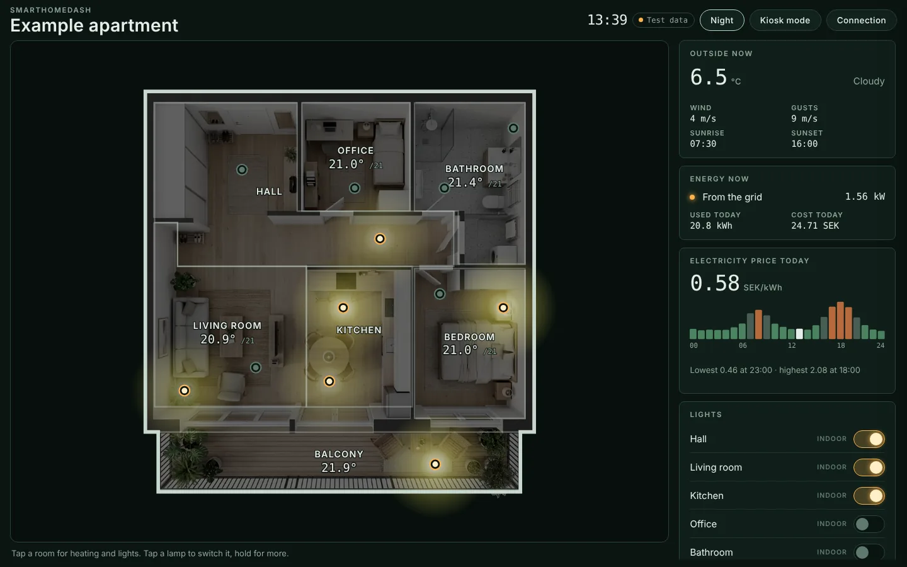

# PlanView Dash

A Home Assistant dashboard that shows your home as a picture. Lights glow where they are, in their own colour, wall lamps wash the facade, windows light up when a room's lamps are on, and solar panels glow green while they produce. Tap a building and the roof lifts to reveal its floor plan, with every lamp and thermostat controllable in place.

**[Try the live demo](https://rsundin.github.io/planview-dash/)**: the example house and apartment on test data, right in your browser.

<p align="center">
  
</p>

- Runs as a panel in the Home Assistant sidebar, behind Home Assistant's own login. No access tokens.
- Set up entirely in the UI: upload a picture of your home and your floor plans, draw rooms, tap where each light and thermostat is.
- Built for wall screens and tablets, with a kiosk mode that shows only the dashboard; on phones, pinch to zoom into the picture. Works in the companion app.
- Houses with a picture from outside, or apartments with just a floor plan. Several homes, each with its own panel.
- Dashboard text in Swedish or English.

<p>
  
  
</p>
<p>
  
  
</p>

## Install

**Marketplace (Home Assistant 2026.11 and newer):** **Settings → Marketplace**, search for **PlanView Dash** and install it. Setup starts right away. The first visit shows a notice that community code is not reviewed by Home Assistant; what PlanView Dash can reach is described in [SECURITY.md](SECURITY.md).

*Not found by the search yet?* **Settings → Marketplace → Add from link**, paste `https://github.com/rsundin/planview-dash` and install **PlanView Dash** (it asks you to sign in with GitHub once).

*Before Home Assistant 2026.11:* open HACS, search for **PlanView Dash**, download it and restart Home Assistant. If the search does not find it yet: HACS → *Custom repositories* → add this repository as an **Integration** → download **PlanView Dash** → restart Home Assistant.

**Manually:** copy `custom_components/planview_dash` to `<config>/custom_components/`, then restart. With SSH: `scripts/deploy.sh user@host`.

Then **Settings → Devices & services → Add integration → PlanView Dash**, give the dashboard a name, and open it from the sidebar. It starts from an example house or apartment you can keep, fill with your own lights, or replace with pictures of your home; a setup guide walks through it.

**→ [Setting up a new dashboard](docs/setup.md)**: the full walkthrough, with tips for the pictures.

**→ [An overview picture without a drone](docs/overview-picture.md)**: a day and evening picture from a 3D map and an AI image model.

## What it shows

| Part | What it does |
| --- | --- |
| Overview picture | Day and evening picture of the property; lights, lit windows and solar panels drawn live on it |
| Lift the roof | Tap a building to open its floor plan |
| Floor plan | Rooms tinted by temperature, every lamp switchable in place, a flame where a room is heating |
| Room panel | Thermostat with target, mode and presets (Comfort, Eco, Frost …), 24-hour temperature graph, dimmers, blinds and curtains, doors, windows and sensors |
| Doors, windows, presence | Open doors and windows, unlocked locks and alarms marked on the floor plan and the building; rooms with someone in them outlined |
| Warnings | Smoke, water leaks, a window open while heating, low batteries, devices not responding |
| Energy flow | One line per flow, from the sun, battery or grid to the house, car, battery or grid, in the colour of the source, with the kilowatts on it, plus a plain sentence in the energy card |
| Dusk and weather | The day picture fades into the evening one as the sun sets; cloud, fog, rain and snow on the picture |
| Cards | Weather, power now, energy today, hourly electricity price with the cheapest hours ahead, outdoor and indoor lights, scenes and scripts, heating per room |
| Card for other dashboards | `custom:planview-dash-card` shows the overview, a floor plan or a room inside any Home Assistant dashboard, with the room panel, lamps and heating working in the card. See [the card](docs/setup.md#the-card) |

## Wall screens and tablets

Open the dashboard with `?kiosk` at the end of its address, for example `http://homeassistant.local:8123/home?kiosk`, or tap **Kiosk mode** in the header and **Start kiosk mode**. Kiosk mode hides Home Assistant's sidebar on that device, hides the dashboard's own buttons and goes full screen on the first touch. Hold the clock for two seconds to leave it.

On a wall screen the dashboard can show the doorbell camera when someone rings, go back to the overview when nobody touches it, dim at night until a motion sensor wakes it, and run in a light mode without blur or animation on older tablets (`?lite`).

For a dedicated tablet, also see [docs/setup.md](docs/setup.md#wall-screens-and-tablets).

## Setup and placement

Administrators get two tools in the dashboard header:

- **Setup** (*Inställningar*): pictures, buildings, solar panels, windows, floor plans and rooms, energy and weather sensors, buttons.
- **Place** (*Placera*): pick a light, switch, thermostat or temperature sensor and tap where it is. The room is found from the tap.

Both save straight to Home Assistant. The config is a readable `site.json` in `<config>/planview_dash/sites/<name>/`; the format is described in [docs/configuration.md](docs/configuration.md).

## YAML

Dashboards can also be defined in `configuration.yaml`, for example to keep a site in version control:

```yaml
planview_dash:
  dashboards:
    - site: home               # folder under <config>/planview_dash/sites/
      title: Home
      icon: mdi:home-lightbulb
      url_path: my-home
      require_admin: false     # true: only administrators see it in the sidebar
  sites_dir: planview_dash/sites   # optional; relative to the config folder
```

These keys, the goodnight action, the card's options and the other names you can type stay the same through 1.x: [Stable in 1.x](docs/configuration.md#stable-in-1x).

## Updating

The Marketplace offers new versions like for any other integration (HACS before Home Assistant 2026.11); restart Home Assistant after updating. Your dashboards and pictures in `<config>/planview_dash/sites/` are not touched by an update. A private fork can be added to HACS as a custom repository.

## Development

No build step: plain HTML, CSS and JavaScript modules.

```bash
python3 -m http.server 8000
```

`http://localhost:8000/` runs the example house standalone on **test data**, the same page as the [online demo](https://rsundin.github.io/planview-dash/), which `.github/workflows/pages.yml` publishes from `main`: lights switch, thermostats respond and temperatures drift. `?site=example-apartment` shows the example apartment: a floor plan only. Add `#edit` for placement mode.

```
custom_components/planview_dash/
  __init__.py              setup and panels
  config_flow.py           adding a dashboard from the UI
  views.py                 dashboard code (public) and site files (logged-in users)
  goodnight.py, sensor.py  the goodnight action and its countdown sensor
  frontend/
    panel.js               panel entry point (runs in the Home Assistant iframe)
    js/main.js             startup, views and navigation
    js/ui/setup.js         setup guide
    js/ui/editor.js        placement mode
    js/views/              overview picture and floor plan
    js/adapters/           data from the panel's hass object, a token, or test data
  example/                 example house and apartment: pictures and config (English and Swedish)
sites/                     sites for the standalone page; example-house links to the example
docs/                      setup guide and config reference
scripts/deploy.sh          copy to Home Assistant over SSH
index.html                 standalone page for development
```

## Privacy

- Everything stays in your Home Assistant: the config and pictures are files in your config folder, served only to logged-in users.
- The dashboard makes no calls to outside services. The typefaces ship with it.
- Pictures you upload are not processed or sent anywhere.

See [SECURITY.md](SECURITY.md) for how access is handled and how to report a problem.

## Roadmap

Next up: a listing in Home Assistant's Marketplace catalog, people and appliances on the picture, the house as a wall-screen screensaver, and a summer house mode. See [ROADMAP.md](ROADMAP.md).

## Help, questions and ideas

- **Something wrong?** Tap **?** in the dashboard (or **Report a problem** in the setup guide). It shows the text first, then opens a GitHub issue filled in with versions, browser, screen and counts, never the names of your rooms or devices. Administrators can attach Home Assistant's *Download diagnostics* for PlanView Dash too (Settings → Devices & services → PlanView Dash → ⋮), which holds counts and sizes only.
- **Questions, ideas and pictures of your dashboard** are welcome in [Discussions](https://github.com/rsundin/planview-dash/discussions): Q&A, Ideas (with votes) and Show and tell.
- **Sharing your dashboard?** A picture of a home says a lot about it. Before posting, see [Sharing your dashboard safely](docs/sharing.md).

## Support

PlanView Dash is free and open source. If it brightens your wall, you can support its development through [GitHub Sponsors](https://github.com/sponsors/rsundin) or [Buy Me a Coffee](https://buymeacoffee.com/rsundin).

## License

MIT, see [LICENSE](LICENSE). The bundled typefaces (Barlow, Barlow Semi Condensed, IBM Plex Mono) are under the SIL Open Font License.
